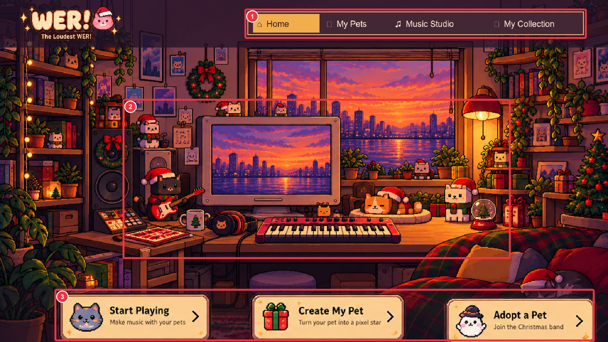
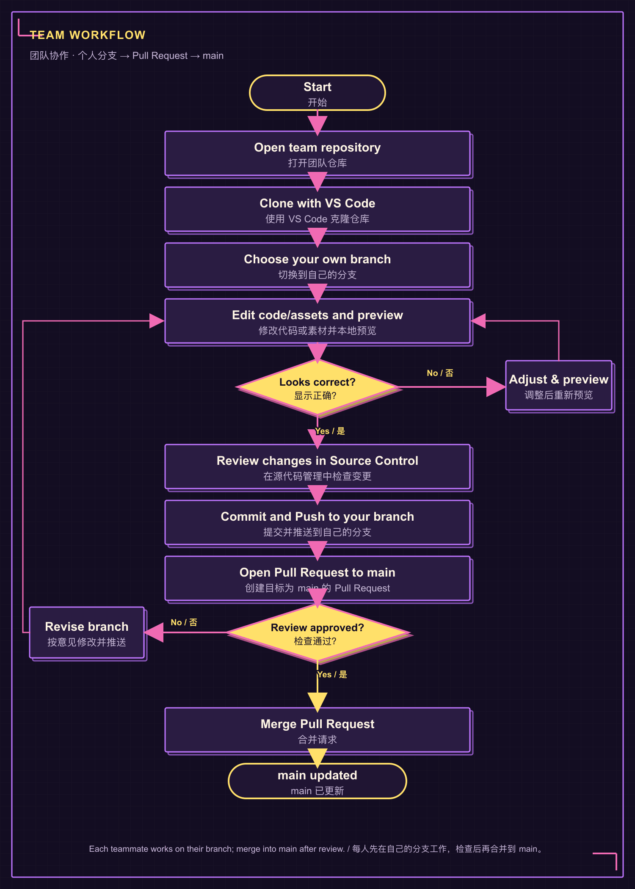

<p align="center">
  
</p>

<h1 align="center">The Loudest WER!</h1>
<p align="center"><strong>A little room, a little band.</strong><br>像素宠物音乐工作室 · Desktop-first browser experience</p>

<p align="center">
  <a href="#website-introduction">Website / 网站</a> ·
  <a href="#run-locally">Run locally / 本地运行</a> ·
  <a href="#team-collaboration">Team / 团队协作</a> ·
  <a href="#replaceable-assets">Assets / 替换素材</a>
</p>

<p align="center">
  
</p>
<p align="center"><sub>Home preview · ① Page navigation　② Interactive room and pets　③ Quick actions</sub></p>

<a id="website-introduction"></a>
## Website introduction · 网站介绍

The Loudest WER! is a desktop-first pixel-pet music playground. Meet the **White Cat**, **Orange Cat**, and **Mystery Cat**, create a pet from a photo, and arrange a song together. The prototype runs in a browser without a build step or account.

The Loudest WER! 是一款桌面优先的像素宠物音乐网页。认识**白猫、橘猫和神秘猫**，上传照片创建宠物，再和宠物一起编曲。初版可直接在浏览器运行，无需构建项目或注册账号。

### Explore the website · 浏览网站

| Page / 页面 | What you can do / 页面功能 |
|---|---|
| **Home · 首页** | Switch between **Sunset · 黄昏** and **Night · 夜晚**, click or drag the three cats, and use the quick links to open other pages. / 切换黄昏与夜晚，点击或拖动三只猫，并通过快捷入口进入其他页面。 |
| **My Pets · 我的宠物** | Create a pixel-style pet preview from a photo, record or upload a short voice, and choose built-in pets. / 上传照片生成像素预览、录制或上传短声音，并选择内置宠物。 |
| **Music Studio · 音乐工作室** | Choose pets and sounds, adjust **Volume, Pitch, Rhythm, Repeat**, use music templates, and play or pause a composition. / 选择宠物和叫声，调节音量、音高、节奏与重复，套用音乐模板并播放或暂停。 |
| **My Collection · 我的收藏** | Reopen or remove compositions saved in this browser. / 打开或移除此浏览器中保存的合奏。 |
| **Gallery · 角色与声音展示** | Browse the project's pet characters and example sounds. / 浏览项目角色和示例声音。 |

Photo processing creates a pixelated visual preview; it is not AI cutout or background removal. Pet profiles and saved music stay in the current browser and do not sync between devices.

照片处理是像素化视觉预览，不是 AI 抠图或背景移除。宠物资料和音乐保存在当前浏览器，不会自动同步到其他设备。

<a id="run-locally"></a>
## Run locally · 本地运行

Open the project root—the folder containing `index.html` and `assets/`—in VS Code. Choose **Terminal → New Terminal**, then run the command for your system:

在 VS Code 打开项目根目录（其中有 `index.html` 和 `assets/`），选择 **Terminal → New Terminal（新建终端）**，再运行对应系统的命令：

**macOS**
```sh
python3 -m http.server 8000
```

**Windows · PowerShell / Windows Terminal**
```powershell
py -m http.server 8000
```

Open [http://localhost:8000/](http://localhost:8000/) in the same computer's browser. Keep the terminal open while previewing; press **Ctrl + C** to stop the server. If port 8000 is busy, change `8000` to `8001` in the command and open [http://localhost:8001/](http://localhost:8001/).

在同一台电脑的浏览器打开 [http://localhost:8000/](http://localhost:8000/)。预览时保持终端开启；按 **Ctrl + C** 停止服务。如果 8000 端口被占用，将命令中的 `8000` 改为 `8001`，并打开 [http://localhost:8001/](http://localhost:8001/)。

Click **Play together** once the first time you play audio to enable browser sound. No separate asset pack is needed: clone or download the complete project and keep the `assets/` folder in place.

第一次播放时点击一次 **Play together（一起演奏）**以启用浏览器音频。素材不需要单独安装：克隆或下载完整项目并保留 `assets/` 文件夹即可。

<a id="team-collaboration"></a>
## Team collaboration · 团队协作

Open the [team repository](https://github.com/sd5913/The-Loudest-WER-). For ongoing work, clone it in VS Code and select **your own branch** before editing. A ZIP download is suitable for viewing, but not for syncing contributions.

打开[团队仓库](https://github.com/sd5913/The-Loudest-WER-)。需要持续协作时，在 VS Code 克隆仓库并先切换到**自己的分支**再修改。下载 ZIP 适合查看项目，不适合持续同步协作内容。

<p align="center">
  
</p>

1. **Clone and branch · 克隆并切换分支:** In VS Code, choose **Git: Clone**, paste the [repository URL](https://github.com/sd5913/The-Loudest-WER-.git), choose a local folder, then switch to your own branch. Git must be installed; sign in when VS Code prompts you.
2. **Edit and preview · 修改并预览:** Make a focused change and run the site locally using the steps above. Check the interaction and review the changed files in VS Code **Source Control**.
3. **Commit and push · 提交并推送:** Commit your changes and Push / Sync to your own branch. Do not push directly to `main`.
4. **Pull Request · 发起合并请求:** On GitHub, open a Pull Request targeting `main`. After review, merge it according to the repository's permissions; teammates can then update from `main`.

在 VS Code 选择 **Git: Clone**，粘贴[仓库地址](https://github.com/sd5913/The-Loudest-WER-.git)，选好本地文件夹后切换到自己的分支。完成修改并本地预览后，在 **Source Control（源代码管理）**检查变更，Commit 并 Push / Sync 到自己的分支；不要直接推送到 `main`。最后在 GitHub 创建目标为 `main` 的 Pull Request，检查后按仓库权限合并。

<a id="replaceable-assets"></a>
## Replaceable assets · 替换素材

Replace files in place where possible: keep the filename, folder, format, image ratio, and transparent canvas so the page can still find the asset and overlays remain aligned. Back up the original, refresh the browser after replacement, then commit and push the change on your own branch.

尽量在原位置替换素材，并保留文件名、目录、格式、图片比例和透明画布，避免页面找不到文件或图层错位。先备份原文件，替换后刷新浏览器检查，再在自己的分支提交并推送。

| Asset / 素材 | Location / 位置 | Note / 注意事项 |
|---|---|---|
| Home backgrounds / 首页背景 | `assets/backgrounds/home-sunset.png`, `home-night.png` | Keep the original ratio; the computer is part of the background. / 保持原图比例；电脑已包含在背景图中。 |
| Home cats / 首页猫咪 | Matching transparent PNGs in `assets/pets/`; Night files include `-night`. / `assets/pets/` 对应透明 PNG；夜晚版本文件名带 `-night`。 | Keep canvas and subject placement similar. / 保持画布和主体位置相近。 |
| Stage background / 工作室背景 | `assets/backgrounds/stage-neon-night.png`, `stage-sunny-park.png` | Replace either PNG in place and keep its filename and canvas ratio. / 原位替换任一 PNG，保留文件名和画布比例。 |
| Example sounds / 示例声音 | WAV files in `assets/sounds/` | Keep WAV format and filenames. / 保持 WAV 格式和文件名。 |
| Home logo and buttons / 首页 Logo 与按钮 | `assets/wer-christmas-ui/` | Keep transparent edges; button canvas is 300 × 100 px. / 保留透明边缘；按钮画布为 300 × 100 像素。 |

## Code map · 代码位置

| Files / 文件 | Used for / 对应功能 |
|---|---|
| `index.html`, `home.js`, `experience.css` | Home page and interactions / 首页与互动 |
| `pets.html`, `pets.js`, `pet-art.js`, `store.js` | Pet creation, voice input, adoption / 创建宠物、声音输入与领养 |
| `studio.html`, `app.js` | Music editor and playback / 音乐编辑与播放 |
| `collection.html`, `collection.js`, `store.js` | Saved music / 已保存音乐 |
| `theme.js`, `style.css`, `pixel-ui.css` | Shared themes and visual system / 全站主题与视觉样式 |

## Guides · 详细说明

- [Website Function Guide · 网站功能说明 (Word)](docs/网站功能说明.docx) — page controls and feature walkthrough / 页面控件与功能说明
- [Team Collaboration and Asset Guide · 团队协作与素材替换说明 (Word)](docs/团队协作与素材替换说明.docx) — GitHub, VS Code, local preview, and asset replacement / GitHub、VS Code、本地预览和素材替换
- [Product specification · 产品功能文档](SPEC.md)

## Saving and sharing · 保存与分享

Music, adopted pets, and custom pet details are stored in this browser only. **Share** copies a local studio URL; it does not upload a song or create a public link. This prototype has no account system, cloud sync, or server-side storage.

音乐、领养宠物和自定义资料仅保存在当前浏览器。**Share（分享）**复制本地工作室网址，不会上传歌曲或生成公开链接。本初版没有账号系统、云端同步或服务器存储。
