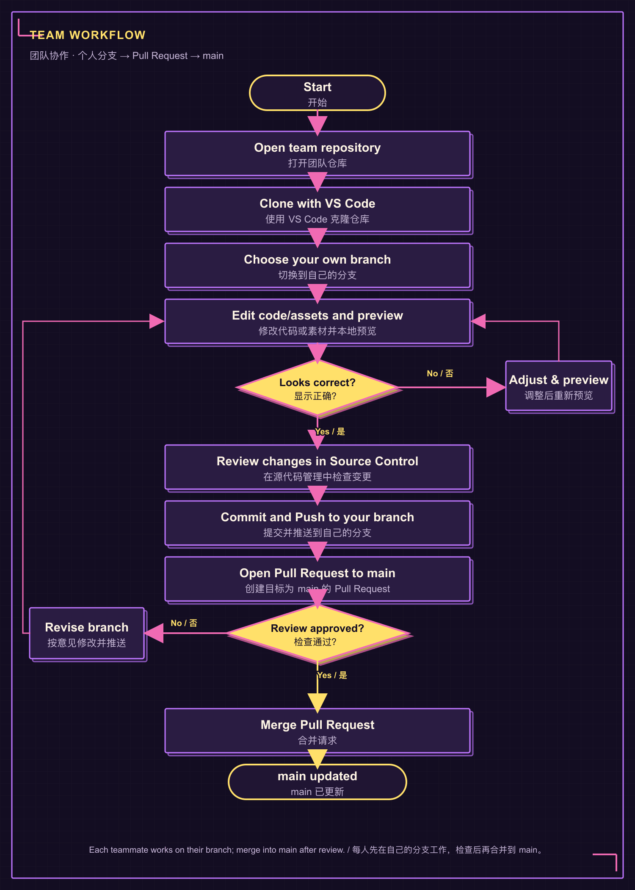
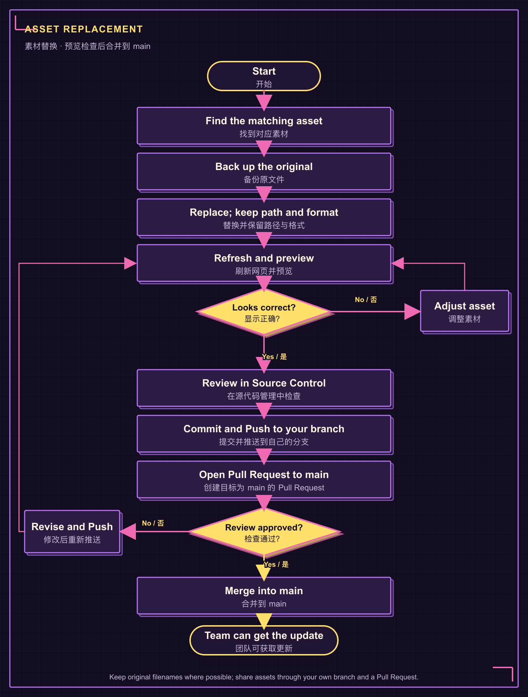

# The Loudest WER! | Team Guide / 团队协作与素材替换说明

**EN:** This quick guide covers GitHub collaboration, local preview, and where to replace artwork and sound.
**中文：** 本指南简要说明 GitHub 协作、本地预览，以及图片和声音素材的替换位置。

## 1. GitHub collaboration / GitHub 协作

**EN:** Push the complete project to the team repository so teammates and the teacher can access the source. A local commit is not visible to others until it is pushed. A GitHub repository does not automatically publish a playable website; online hosting requires a separate GitHub Pages setup.
**中文：** 将完整项目推送到团队仓库，团队成员和老师才能看到源文件。本地 Commit 后，其他人还看不到，直到 Push 到 GitHub。GitHub 仓库不会自动发布成可玩的网页；在线托管需要另外配置 GitHub Pages。

**EN:** Recommended flow: clone in VS Code → work on your own branch → edit and preview → review changes in **Source Control** → Commit and Push to your branch → open a Pull Request targeting `main` → review → merge into `main`. Each teammate should work on their own branch. Confirm repository access and merge permissions with the team.
**中文：** 建议流程：在 VS Code 克隆仓库 → 在自己的分支修改并预览 → 在 **Source Control（源代码管理）**检查变更 → Commit 并 Push 到自己的分支 → 创建目标为 `main` 的 Pull Request → 检查后合并到 `main`。每位成员都使用自己的分支；开始前确认仓库访问和合并权限。

### Team workflow / 团队协作流程



**EN:** The Pull Request targets `main`; whether you can merge it yourself depends on repository permissions and branch rules. If GitHub blocks the merge, ask a teammate with merge access to review and merge it.
**中文：** Pull Request 的目标是 `main`；你能否自己点击合并，取决于仓库权限和分支规则。如果 GitHub 不允许合并，请有权限的团队成员检查并合并。

**EN:** VS Code Source Control can commit and sync your changes to the selected branch. Online publishing is a separate step.
**中文：** VS Code 的 Source Control 可将修改 Commit 并同步到当前选择的分支。要让其他人通过网址访问网站，还需另行发布。

## 2. Do I need to install an asset pack? / 需要单独安装素材包吗？

**EN:** No. There is no separate asset-pack installer. Images and sounds are regular project files inside `assets/`. Clone or download the **entire project**, including `assets/`; keep the folder structure unchanged. If you add or replace a shared asset, commit and push it to your own branch, then open a Pull Request to `main`.
**中文：** 不需要。素材包没有单独的安装程序，图片和声音就是 `assets/` 里的普通项目文件。克隆或下载时要获取**完整项目**，包括 `assets/` 文件夹，并保持原目录结构。新增或替换共用素材后，将文件提交、推送到自己的分支，再创建合并到 `main` 的 Pull Request。

## 3. Preview locally / 本地预览

**EN:** Open the project root (the folder containing `index.html` and `assets/`) in Terminal on macOS or PowerShell / Windows Terminal on Windows. In VS Code, choose **Terminal → New Terminal** to open a terminal in the project folder. Run the command for your system:
**中文：** 在 macOS 打开 Terminal，或在 Windows 打开 PowerShell / Windows Terminal。也可以在 VS Code 选择 **Terminal → New Terminal**，它会在项目文件夹中打开终端。请按系统运行对应命令：

```sh
# macOS
python3 -m http.server 8000
```

```powershell
# Windows
py -m http.server 8000
```

**EN:** Visit <http://localhost:8000/> and keep the terminal open. Stop with **Ctrl + C**. If port 8000 is busy, use `8001` in both the command and URL, then open <http://localhost:8001/>. `localhost` works only on your own computer; it is not a link to send to the teacher. If the URL still fails, paste the last few terminal lines to an AI assistant and ask which localhost address the output indicates; ask it not to guess the port.
**中文：** 打开 <http://localhost:8000/>，预览时保持终端窗口开启；按 **Ctrl + C** 停止服务。若 8000 端口被占用，把命令和网址里的端口都改成 `8001`，再打开 <http://localhost:8001/>。`localhost` 只在自己的电脑上有效，不能作为发给老师的网址。如果仍打不开，把终端最后几行发给 AI，并要求它依据输出判断 localhost 地址，不要猜端口。

## 4. Asset locations / 素材位置

**EN:** Keep the existing filename and path when replacing a file. If you rename or move it, update the matching HTML, CSS, or JavaScript reference.
**中文：** 替换素材时尽量保留原文件名和路径；如果改名或移动位置，也要更新对应的 HTML、CSS 或 JavaScript 引用。

| Asset / 素材 | File path / 文件路径 | Notes / 说明 |
|---|---|---|
| Home sunset and night backgrounds / 首页黄昏与夜晚背景 | `assets/backgrounds/home-sunset.png`<br>`assets/backgrounds/home-night.png` | **EN:** Keep the original 1672 × 941 ratio. The computer is painted into these backgrounds. **中文：** 保持原图 1672 × 941 比例；电脑已画在背景图里。 |
| Mystery Cat / 神秘猫 | `assets/pets/mystery-cat-guitar.png`<br>`assets/pets/mystery-cat-guitar-night.png` | **EN:** Transparent PNG; keep the canvas and subject placement similar across themes. **中文：** 使用透明 PNG；两种主题的画布和主体位置尽量一致。 |
| Orange Cat / 橘猫 | `assets/pets/orange-cat-christmas.png`<br>`assets/pets/orange-cat-night.png` | **EN:** Sunset and night versions. **中文：** 黄昏与夜晚各有一份。 |
| White Cat / 白猫 | `assets/pets/white-cat-christmas.png`<br>`assets/pets/white-cat-night.png` | **EN:** Sunset and night versions. **中文：** 黄昏与夜晚各有一份。 |
| Header logos / 顶栏 Logo | `assets/wer-christmas-ui/logo_sunset.png`<br>`assets/wer-christmas-ui/logo_night.png` | **EN:** Preserve transparency and aspect ratio. **中文：** 保留透明边缘和长宽比例。 |
| Home buttons / 首页按钮 | `assets/wer-christmas-ui/button_start_sunset_uniform.png`<br>`button_start_night_uniform.png`<br>`button_create_sunset_uniform.png`<br>`button_create_night_uniform.png`<br>`button_adopt_sunset_uniform.png`<br>`button_adopt_night_uniform.png` | **EN:** These six files are displayed; keep the 300 × 100 px canvas. **中文：** 网页显示这六个文件；画布保持 300 × 100 px。 |
| Example sounds / 示例叫声 | `assets/sounds/cat-call.wav`<br>`dog-call.wav`, `bird-call.wav`, `bunny-call.wav`, `frog-call.wav`, `fox-call.wav` | **EN:** Keep WAV format and filenames. The home cats use `cat-call.wav`. **中文：** 保持 WAV 格式和文件名；首页猫咪使用 `cat-call.wav`。 |
| Studio background / 工作室背景 | `assets/backgrounds/seaside-park.png` | **EN:** Keep this filename; add the file here if it is missing. **中文：** 保留此文件名；如果目录里没有，请新增在这里。 |
| Pet list thumbnails / 宠物列表小图 | `assets/pets/cat.png`, `dog.png`, `bird.png`, `bunny.png`, `frog.png`, `fox.png` | **EN:** These are different from the large Home cat sprites. **中文：** 这组是宠物列表小图，与首页猫咪大图不同。 |

### Asset replacement workflow / 替换素材流程



**EN:** To replace art, back up the old file, export the new image as PNG or sound as WAV, replace the matching file, refresh the page, then review the change in VS Code **Source Control**. Commit and Push it to your own branch, open a Pull Request to `main`, and merge after review. Use only team-made or licensed material. The Home computer is already part of the wallpaper; no separate computer PNG is required.
**中文：** 替换时先备份旧文件，图片导出为 PNG、声音导出为 WAV，再覆盖对应文件并刷新网页；随后在 VS Code 的 **Source Control（源代码管理）**检查变更。Commit 并 Push 到自己的分支，再创建目标为 `main` 的 Pull Request，检查通过后合并。只使用团队自制或已获授权的素材。首页电脑已经包含在背景图里，无需另加电脑 PNG。

## 5. Main code files / 主要代码文件

| Change / 要修改的内容 | Files / 文件 |
|---|---|
| Home page and cat positions / 首页与猫咪位置 | `index.html`, `home.js`, `experience.css` |
| Pet creation and adoption / 创建与领养宠物 | `pets.html`, `pets.js`, `pet-art.js` |
| Music studio and sound controls / 音乐工作室与声音控制 | `studio.html`, `app.js` |
| Saved music / 已保存音乐 | `collection.html`, `collection.js`, `store.js` |
| Shared layout and pixel styling / 全站布局与像素风格 | `style.css`, `pixel-ui.css`, `experience.css` |

**EN:** Before syncing changes, preview the pages you changed, review the file list, and make sure no passwords, API keys, private recordings, or private photos are included.
**中文：** 同步修改前预览改过的页面、检查文件列表，并确认没有包含密码、API Key、私人录音或私人照片。
