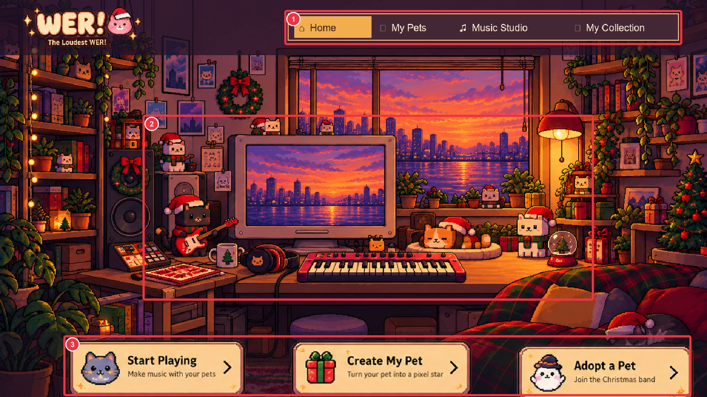
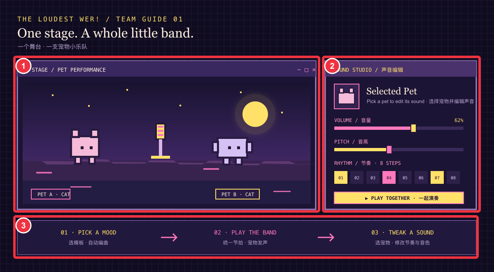

# The Loudest WER! · Website Function Guide / 网站功能说明

本说明只介绍网站页面、互动方式和音乐调节控件。团队如何下载、协作和替换素材，请看[团队协作与素材替换说明](团队协作与素材替换说明.md)。

## Pages / 页面导航

顶部导航可在 **Home · 首页**、**My Pets · 我的宠物**、**Music Studio · 音乐工作室**、**My Collection · 我的收藏**之间切换；**Gallery · 角色与声音展示**可浏览宠物角色和示例声音。

## Home · 首页

- **顶部导航（Top navigation）**：切换首页、宠物、工作室和收藏页面。
- **互动房间（Interactive room）**：点击白猫、橘猫或神秘猫，猫咪会在原位稍微放大并播放叫声；再次点击可恢复大小。点击灯绳可在 **Sunset · 黄昏**和 **Night · 夜晚**之间切换。
- **调整位置（Arrange）**：拖动猫咪调整位置；**Reset · 恢复默认**还原当前主题下的位置。
- **快捷入口（Quick actions）**：**Start Playing · 开始一起演奏**进入工作室；**Create My Pet · 创建我的宠物**进入宠物创建页；**Adopt a Pet · 领养一位伙伴**跳转到领养区域。

## My Pets · 我的宠物

- 上传宠物照片，生成浏览器中的像素化预览；这是视觉像素效果，不是 AI 抠图或背景移除。
- 录制短声音或上传声音文件，为自定义宠物添加音色。录音最长 8 秒；工作室会用浏览器音频效果和音高变化处理声音。
- 在领养区域选择内置宠物，包括 **White Cat · 白猫、Orange Cat · 橘猫、Mystery Cat · 神秘猫**。
- 宠物资料和声音保存在当前浏览器，不会自动同步到其他设备。

## Music Studio · 音乐工作室

> 图片是功能布局示意图，用来帮助识别控件分区；实际网页会随屏幕尺寸调整布局。

1. **Stage · 宠物舞台**：选择场景并加入宠物。点击宠物后，右侧面板会显示该宠物的声音设置。
2. **Sound Editor · 声音编辑**：
   - **Volume · 音量**：调节播放音量。
   - **Pitch · 音高**：调节音高。
   - **Rhythm · 节奏**：选择八拍节奏；点击节奏格可打开或关闭对应拍点。
   - **Repeat · 重复**：控制节奏循环。
   - **Sound · 选择叫声**：切换预设叫声或上传宠物声音。
3. **Templates / Playback · 模板与播放**：选择音乐模板自动安排节奏，再使用 **Manual Edit · 手动修改**调整；**Surprise Me · 随机合奏**随机组合；**Play together / Pause · 一起演奏 / 暂停**控制播放；**Save Music · 保存音乐**保存作品。

## My Collection · 我的收藏

查看当前浏览器保存的音乐，可重新打开工作室继续编辑或移除记录。**Share · 分享**复制本地工作室网址，不会上传音乐，也不会生成他人可访问的公开链接。

## Gallery · 角色与声音展示

浏览项目宠物角色与示例声音。声音预览由当前浏览器播放，不会上传到服务器。

## Saving · 保存方式

音乐、领养宠物和自定义宠物资料保存在当前设备的浏览器中，不会自动同步到团队成员的设备。清除浏览器数据可能导致本地保存内容丢失。
